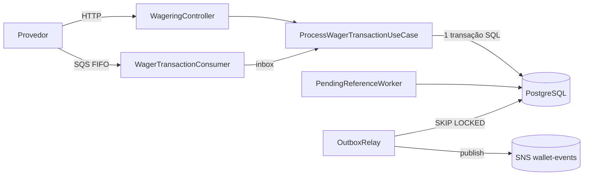

# Arquitetura e decisões

Este documento explica como o serviço garante os invariantes do desafio (não duplicar créditos nem débitos, não perder eventos confirmados, nunca permitir saldo negativo) e por que cada escolha foi feita. A seção final lista as limitações conhecidas.

## 1. Visão geral

Camadas:

| Camada | Responsabilidade | Depende de |
|---|---|---|
| `domain` | Regras, invariantes e transições (`Money`, `Wallet`, `WagerTransaction`, `WalletLedgerEntry`, eventos, inbox/outbox) | nada |
| `application` | Casos de uso que orquestram o domínio; portas `Clock` e `IdGenerator` | `domain` |
| `infrastructure` | MikroORM (records, mappers, repositórios), SQS, SNS, logs e métricas | `domain` |
| `http` / `messaging` | Adaptadores de entrada: validação, tradução de erros, fronteira transacional | `application` |

O mesmo caso de uso atende HTTP e SQS. O caso de uso **não abre transação**: recebe o `EntityManager` transacional de quem o chama. Assim o consumidor SQS consegue colocar a inbox na mesma transação, e a regra de negócio existe em um lugar só.

## 2. Modelagem

- Toda entidade tem construtor privado e factories estáticas (`create`, `open`, `from`, `enqueue`, `rehydrate`). O estado mutável é privado e muda apenas por métodos de transição.
- `rehydrate` reconstrói o que já foi persistido **sem revalidar transições**: as regras validam mudanças, e o que está no banco já passou por elas e pelas constraints do schema.
- **Domínio separado da persistência.** As classes de domínio não importam MikroORM nem NestJS. Existe uma segunda camada de classes (`*Record`) mapeada pelo ORM, e mappers convertem nos dois sentidos, sempre lendo via `rehydrate`. O custo é escrever os mappers; o ganho é testar todas as regras sem banco (50 testes de unidade em milissegundos) e manter o domínio independente de infraestrutura.
- Relógio e geração de IDs são injetados. Nenhuma classe de domínio chama `new Date()` ou gera UUID, o que deixa os testes determinísticos.
- IDs são UUID v7 (ordenados por tempo, melhores para índices B-tree), gerados por `Bun.randomUUIDv7()` atrás da porta `IdGenerator`.
- Não existe agregado `Round`: a rodada é o campo `roundId`, e sua consistência vem da validação de referência (mesma rodada, mesmo player, mesma wallet, mesma moeda).

## 3. Money

- **Representação interna:** `bigint` em unidades mínimas (centavos). A escala é fixa em 2 casas, então `"25.07"` vira `2507n`, sem dependência externa e com aritmética exata. A conversão de string para centavos nunca passa por ponto flutuante.
- **Contratos:** sempre string decimal com exatamente 2 casas, `{ "amount": "25.00", "currency": "BRL" }`. `toJSON()` garante o formato e evita o erro de `JSON.stringify` com `bigint`.
- **Validação de entrada (`Money.from`):** regex `^(0|[1-9]\d*)\.\d{2}$`. Rejeita `NaN`, `Infinity`, notação científica, string vazia, sinal, zero à esquerda, `number` em vez de string, mais **ou menos** que 2 casas. Optei pela leitura estrita de "escala fixa de 2 casas" também na entrada; não há arredondamento, entradas fora do formato são recusadas.
- **Negativos:** proibidos na entrada, permitidos internamente (`negate`, `subtract`). Por isso há duas portas: `from` (estrita, para dados externos) e `fromMinorUnits` (persistência).
- **Moedas:** o modelo é multi-moeda; operações entre moedas diferentes lançam `CurrencyMismatchError`. O desafio roda com `BRL`.
- **Persistência:** duas colunas, `amount BIGINT` e `currency CHAR(3)`. Nos records o valor é `string` (o driver do Postgres devolve `BIGINT` como texto), convertido com `BigInt()` no mapper. `number` não aparece no caminho do dinheiro.

## 4. ORM e estratégia transacional

- **MikroORM 7**, com decorators legacy (`@mikro-orm/decorators/legacy`) e `ReflectMetadataProvider` explícito, como a v7 exige.
- Cada operação roda em `em.fork().transactional(...)`: um EntityManager isolado por requisição ou mensagem, com sua própria conexão e Identity Map. Isso também é o que dá paralelismo real nos testes.
- **Unit of Work:** transação, lançamento, wallet e eventos são registrados com `persist` e gravados juntos no commit. Ou tudo entra, ou nada.
- **Chaves estrangeiras `DEFERRABLE INITIALLY DEFERRED`:** a ordem de inserção dentro do flush deixa de importar; as FKs são conferidas no commit.
- **SQL direto onde o ORM não expressa a garantia:** `INSERT ... ON CONFLICT DO NOTHING` na inbox, `FOR UPDATE SKIP LOCKED` no relay, `SET LOCAL lock_timeout`, `REPEATABLE READ READ ONLY` na reconciliação.
- **`inTransaction`:** se o commit falhar por violação de `UNIQUE` (corrida entre duas requisições com a mesma chave em wallets diferentes), repete uma vez; na segunda tentativa o caso de uso encontra a transação gravada e responde como replay ou conflito.
- Migrations escritas à mão em SQL, com `up` e `down`, e snapshot do MikroORM desligado: o schema depende de `CHECK`, índices parciais e triggers que o ORM não gera.

## 5. Concorrência

**Estratégia: lock pessimista por wallet** (`SELECT ... FOR UPDATE` via `LockMode.PESSIMISTIC_WRITE`), com `version` mantido como defesa adicional.

Por que pessimista:

- **Transação curta e sem I/O externo.** Eventos vão para a outbox, então nenhuma chamada de rede acontece com a wallet travada.
- **Sem retry sob disputa.** No otimista, operações concorrentes na mesma wallet falham e repetem; no pessimista, esperam alguns milissegundos.
- **Toda a validação acontece com a wallet travada:** idempotência, dono, moeda, referência, reversão única e saldo. Um `UPDATE ... WHERE balance >= x` protegeria só o saldo.
- **Sem deadlock possível:** cada transação trava exatamente uma wallet. O worker de pendentes também processa uma pendente por transação, justamente para não travar wallets em ordem cruzada.
- **Lock por linha, não global:** wallets diferentes processam em paralelo (testado com 10 wallets simultâneas).

Ordem dentro da transação: trava a wallet **antes** de checar idempotência. Duas cópias da mesma mensagem processadas ao mesmo tempo em instâncias diferentes ficam em fila no lock; quando a segunda entra, a primeira já foi gravada e ela vira replay.

Defesas no schema contra lost update: `CHECK (balance >= 0)` e `UNIQUE (wallet_id, wallet_version)` no ledger. A versão sobe exatamente uma vez por mudança de saldo, então dois lançamentos nunca podem sair da mesma versão.

**Hot wallet:** `SET LOCAL lock_timeout = '5s'`. Uma espera maior falha como erro transitório (`503` na API, retry com backoff na fila) em vez de segurar conexões indefinidamente. A espera é medida em `wallet_lock_wait_seconds` e os estouros em `wallet_lock_timeouts_total`. O throughput de uma única wallet fica limitado a uma transação por vez; é o preço da correção e está registrado nas limitações.

**Broker:** as mensagens são publicadas com `MessageGroupId = walletId`, o que faz a FIFO serializar cada wallet e reduz a disputa por lock. É otimização: a deduplicação da FIFO dura 5 minutos e a ordem não sobrevive a retries, então a correção não depende dela.

## 6. Idempotência

Três camadas, todas persistentes:

| Camada | Protege | Mecanismo |
|---|---|---|
| Idempotency key | a operação de negócio | `UNIQUE (idempotency_key)` e `UNIQUE (provider_id, external_transaction_id)` |
| Inbox | a mensagem de transporte | `PRIMARY KEY (consumer_name, message_id)` com `INSERT ... ON CONFLICT DO NOTHING` |
| Ledger | o efeito financeiro | `UNIQUE (transaction_id, wallet_id)` e `UNIQUE (wallet_id, wallet_version)` |

- **HTTP:** o header `Idempotency-Key` é obrigatório e é a fonte da verdade. **SQS:** a key vem em `data.idempotencyKey`.
- **Replay:** mesma key e mesmo hash devolvem o resultado original, incluindo o saldo observado na decisão (`balance_after` gravado na própria transação, inclusive para `LOSS` e `REJECTED`, que não geram lançamento).
- **Conflito:** mesma key com hash diferente é `IDEMPOTENCY_CONFLICT` (409 na API, DLQ na fila). Também é conflito uma key diferente para um `(providerId, externalTransactionId)` já existente.
- **Inbox:** usa o `messageId` do envelope, não o `MessageId` do SQS, que muda quando o provedor republica.

**Algoritmo do `payloadHash`:** SHA-256 em hexadecimal de um JSON canônico (chaves ordenadas recursivamente, campos `undefined` omitidos) contendo apenas `providerId`, `externalTransactionId`, `playerId`, `walletId`, `roundId`, `gameId`, `kind`, `money` (já normalizado pelo `Money`) e `referenceExternalTransactionId`. Header, `occurredAt` e quaisquer campos extras ficam de fora.

## 7. Garantias no schema

| Garantia | Constraint |
|---|---|
| Saldo nunca negativo | `wallet.balance CHECK (>= 0)`; `balance_before` e `balance_after` do ledger `CHECK (>= 0)` |
| Uma wallet por player e moeda | `UNIQUE (player_id, currency)` |
| Ledger na moeda da wallet | FK composta `(wallet_id, currency) → wallet(id, currency)` |
| Lançamento aritmeticamente correto | `CHECK` de `balance_after = balance_before ± amount` conforme a direção |
| Valor do lançamento positivo | `CHECK (amount > 0)` |
| Ledger imutável | triggers que recusam `UPDATE`, `DELETE` e `TRUNCATE` |
| Transação terminal imutável | trigger que recusa qualquer `UPDATE` em `PROCESSED`, `REJECTED` ou `FAILED` |
| Campos de negócio da transação imutáveis | o mesmo trigger compara provider, IDs, valor, moeda, kind etc. |
| Transação não pode ser apagada | trigger `BEFORE DELETE` |
| Referência obrigatória e permitida por kind | `CHECK` por kind |
| Coerência de status | `processed_at` sse `PROCESSED`; `failure_code` sse `REJECTED`/`FAILED`; agendamento sse `PENDING_REFERENCE`; reversão processada tem referência resolvida |
| Reversão única | índice único parcial em `reference_transaction_id` para `REFUND`/`ROLLBACK` processados |

A FK da `wager_transaction` aponta apenas para `wallet(id)`, sem a moeda: uma transação em moeda errada precisa ser gravada como `REJECTED` (`CURRENCY_MISMATCH`) para que o replay devolva a mesma rejeição. A regra de moeda é garantida no ledger, onde o dinheiro se move.

Índices parciais mantêm baratas as buscas operacionais: pendentes por referência, pendentes vencidas e outbox não publicada.

## 8. Regras de negócio e interpretações

- **Reversão única, por qualquer tipo.** O enunciado proíbe reverter "duas vezes pelo mesmo tipo de operação". Ao pé da letra, um BET poderia receber um `REFUND` **e** um `ROLLBACK` e ser devolvido duas vezes. Adotei a leitura estrita: uma transação só pode ser revertida uma vez, por qualquer reversão (`ALREADY_REVERSED`). Desfazer um refund continua possível com `ROLLBACK` do `REFUND`.
- **`WIN` com referência** aponta para um `BET` da mesma rodada; se a referência ainda não chegou, também vai para `PENDING_REFERENCE`. `WIN` sem referência credita direto.
- **Referência que existe mas também está pendente** faz a transação esperar, em vez de rejeitar.
- **Ordem de validação da referência:** existência, pertencimento (wallet, player, rodada, moeda), tipo compatível, status `PROCESSED`, reversão já feita, valor igual.
- **`ROLLBACK` inverte a direção da referência:** de `BET` credita; de `WIN` ou `REFUND` debita. Se o débito deixaria o saldo negativo, `REVERSAL_INSUFFICIENT_FUNDS`, distinto de `INSUFFICIENT_FUNDS`.
- **`LOSS`** aceita valor `0.00` e não move saldo nem gera lançamento; os demais kinds exigem valor positivo.
- **Player ou moeda diferentes da wallet** viram `REJECTED` gravado (`WALLET_MISMATCH`, `CURRENCY_MISMATCH`).
- **Wallet inexistente** não pode ser gravada (FK): `404` na API, DLQ na fila.
- **`OPENING`** é interno: a borda aceita apenas os cinco kinds externos. A transação de abertura usa valores fixos em vez de colunas nulas: `providerId: "internal"`, `externalTransactionId: "opening:{walletId}"`, `roundId: "opening"`, `gameId: "internal"`.

## 9. Referências fora de ordem

- Referência ausente: a transação é gravada como `PENDING_REFERENCE`, com o evento `WagerTransactionPendingReference`.
- O `PendingReferenceWorker` busca as vencidas e processa **uma por transação**, travando a wallet e recarregando a transação (outra instância pode tê-la resolvido).
- **Backoff:** 1s, 2s, 4s... teto de 60s entre tentativas.
- **TTL: 30 minutos** desde o recebimento, configurável por `PENDING_REFERENCE_TTL_MS`. Escolhi tempo em vez de número de tentativas porque é mais fácil de operar e explicar. Mensagens fora de ordem numa fila se desencontram por segundos ou poucos minutos (retries, paralelismo); 30 minutos cobre com folga uma indisponibilidade curta do provedor sem deixar uma transação presa por horas. Em produção o valor viria de dados reais de atraso.
- Expirado: `REJECTED` com `REFERENCE_NOT_FOUND` e `WagerTransactionRejected` na outbox, na mesma transação.

## 10. Códigos de falha

| Código | Quando | Ação esperada do provedor |
|---|---|---|
| `INSUFFICIENT_FUNDS` | BET sem saldo | desistir |
| `REVERSAL_INSUFFICIENT_FUNDS` | ROLLBACK de WIN/REFUND sem saldo | desistir; exige tratamento operacional |
| `CURRENCY_MISMATCH` | moeda diferente da wallet | corrigir payload |
| `WALLET_MISMATCH` | player não é dono da wallet | corrigir payload |
| `REFERENCE_NOT_FOUND` | referência não chegou dentro do TTL | desistir |
| `REFERENCE_MISMATCH` | referência de outra wallet, player, rodada ou moeda | corrigir payload |
| `REFERENCE_INVALID_KIND` | ex.: REFUND apontando para WIN | corrigir payload |
| `REFERENCE_NOT_PROCESSED` | referência rejeitada ou com falha | desistir |
| `REFERENCE_AMOUNT_MISMATCH` | valor diferente da referência (reversão parcial fora de escopo) | corrigir payload |
| `ALREADY_REVERSED` | referência já revertida | desistir (já foi feito) |

Erros de borda, que não viram transação gravada: `INVALID_PAYLOAD`, `INVALID_AMOUNT` (400), `WALLET_NOT_FOUND`, `NOT_FOUND` (404), `IDEMPOTENCY_CONFLICT`, `WALLET_ALREADY_EXISTS` (409), `TEMPORARILY_UNAVAILABLE` (503). Toda resposta de erro traz `retryable`.

## 11. Mapeamento HTTP

| Situação | Status |
|---|---|
| Processada (primeira vez / replay) | `201` / `200` |
| `PENDING_REFERENCE` | `202` |
| `REJECTED` por regra de negócio | `422`, com o corpo completo da transação |
| Payload inválido | `400` |
| Conflito de idempotência, wallet duplicada | `409` |
| Não encontrado | `404` |
| Falha transitória (Postgres/fila fora, `lock_timeout`, deadlock) | `503` + `Retry-After` |

O mapeamento fica num único `ExceptionFilter`. O domínio não conhece HTTP: lança `DomainError` com `code` estável, e o filtro traduz. Erros `500` não expõem detalhes ao cliente.

## 12. Consumidor SQS

- **Ack somente após o commit:** inbox, transação, wallet, ledger e outbox numa transação; `DeleteMessage` só depois que ela retorna.
- **Classificação de erros:**
  - *Negócio* (saldo insuficiente, referência inválida, replay): já viram resultado gravado dentro do caso de uso, então a mensagem é confirmada.
  - *Transitório* (códigos Postgres `40001`, `40P01`, `55P03`, `57P01`, `53300`, classe `08`, erros de rede): sem ack; `ChangeMessageVisibility` com `min(2^receiveCount, 300)` segundos.
  - *Permanente* (JSON inválido, schema, kind desconhecido ou `OPENING`, valor mal formatado, wallet inexistente, conflito de idempotência ou de inbox): enviado direto para a DLQ com o motivo em `MessageAttributes.reason`, depois apagado da fila principal. Esperar 5 tentativas só atrasaria o grupo FIFO da wallet.
  - *Desconhecido:* tratado como transitório. No pior caso esgota as tentativas e vai para a DLQ pela redrive policy, sem perder nada.
- **Limite de tentativas:** `maxReceiveCount = 5` na redrive policy da fila.
- **`SIGTERM`:** para de buscar (aborta o long polling), espera as mensagens em andamento por até 8s e devolve as restantes com `VisibilityTimeout: 0`. `stop_grace_period: 15s` no Compose dá folga. Se o processo morrer sem nada disso, a transação em andamento é desfeita e a mensagem reaparece após o visibility timeout: o desligamento gracioso acelera a retomada, mas a correção não depende dele.

## 13. Transactional Outbox

- O evento é inserido na `outbox_message` na **mesma transação** da alteração financeira. O `id` da linha é o `eventId`.
- O `OutboxRelay` busca pendentes com `FOR UPDATE SKIP LOCKED`, publica no SNS e marca `published_at`. Várias instâncias trabalham em lotes disjuntos. Se uma morrer, o Postgres desfaz a transação dela, libera os locks e outra publica.
- **Duplicação limitada:** as marcações são confirmadas no commit do lote; se a instância morrer no meio, os eventos daquele lote que já saíram são publicados de novo. Por isso o lote é pequeno (20). Duplicação nunca é indefinida, e consumidores deduplicam pelo `eventId`.
- **Falha do SNS:** `scheduleRetry` com backoff exponencial (teto de 60s) e jitter de 20%. O evento nunca é descartado.
- **Ordem:** relays paralelos podem publicar eventos de uma wallet fora de ordem. `WalletBalanceChanged` carrega `walletVersion`, então um consumidor que mantém saldo pode descartar versões antigas.
- Tópico SNS padrão `wallet-events`, com a fila `wallet-events-audit` inscrita para inspeção.

| Evento | Quando |
|---|---|
| `WagerTransactionProcessed` | qualquer transação aplicada, inclusive `LOSS` e `OPENING` |
| `WalletBalanceChanged` | somente quando o saldo muda |
| `WagerTransactionRejected` | rejeição por regra de negócio, inclusive `REFERENCE_NOT_FOUND` |
| `WagerTransactionPendingReference` | referência ausente |

Replays não geram eventos. Envelope: `eventId`, `eventType`, `version`, `aggregateId` (walletId), `correlationId` (key ou `messageId` de origem, compartilhado por todo o fluxo), `causationId` (causa imediata) e `occurredAt`. O `data` usa `MoneyProps` (strings), nunca a instância de `Money`.

## 14. Autenticação

Não implementada, por decisão de timebox: o enunciado a deixa fora da pontuação e pede que ela não concorra com correção financeira e concorrência.

Ponto de extensão: `AuthGuard` aplicado nos controllers de wallets e wagering, hoje permitindo tudo. Health e métricas ficam abertos.

Desenho proposto: Keycloak no Docker Compose; cada provedor é um client OIDC que obtém token pelo fluxo **client credentials**; o guard valida o JWT pela chave pública (JWKS) do IdP e extrai o `providerId` do token; o caso de uso rejeita transações cujo `providerId` difere do autenticado. Mensagens da fila são canal interno confiável, mas continuam passando pelas mesmas validações de domínio.

## 15. Observabilidade

- **Logs JSON** no stdout, com `correlationId`, `messageId`, `transactionId`, `walletId` e `providerId` propagados por `AsyncLocalStorage`, sem passagem manual. Chaves com nome de valor financeiro ou credencial são substituídas por `[REDACTED]`; payloads inteiros não são logados.
- **Métricas Prometheus** em `/metrics`:

| Pedido | Métrica |
|---|---|
| Transações por status | `wager_transactions_total{source,kind,status,failure_code}` |
| Duplicatas detectadas | `wager_duplicates_total{source,outcome}` |
| Retries | `wager_retries_total{component}` |
| Mensagens em DLQ | `wager_dlq_messages_total{reason}`, `wager_dlq_depth` |
| Conflitos de lock | `wallet_lock_wait_seconds`, `wallet_lock_timeouts_total` |
| Outbox lag | `outbox_lag_seconds`, `outbox_pending` |
| Latência | `wager_processing_duration_seconds{source,kind}` |
| Divergência de reconciliação | `wallet_reconciliation_mismatches_total` |

Com lock pessimista não existe "conflito" como no otimista; a métrica equivalente é o tempo de espera pelo lock e os estouros de `lock_timeout`. Nenhum ID entra como label (cardinalidade): IDs ficam nos logs.

- **Health:** `/health/live` não consulta dependências (para o orquestrador não reiniciar todas as instâncias quando o banco oscila); `/health/ready` checa PostgreSQL e SQS com timeout de 2s.
- **Reconciliação:** lê saldo e ledger numa transação `REPEATABLE READ READ ONLY` (foto consistente sem travar apostas), loga e conta divergências e **nunca corrige sozinha**.

## 16. Estratégia de testes

- **Unidade:** domínio puro, sem infraestrutura.
- **Integração e concorrência:** PostgreSQL e LocalStack reais. Nenhum mock de banco ou fila.
- **Invariante global** (`saldo == ledger`) verificado depois de cada teste de integração/concorrência, para todas as wallets do banco.
- **Determinismo:** relógio e IDs injetados; o worker de pendentes aceita um `asOf` para simular a passagem do tempo; esperas usam polling com prazo, nunca `sleep` fixo como condição.
- **Paralelismo real:** cada operação concorrente usa seu próprio `em.fork()` e conexão.
- **Processos reais:** instâncias da aplicação sobem com `Bun.spawn`, contra uma fila SQS exclusiva da execução.
- **Injeção de falha:** `CRASH_AFTER_COMMIT=true` encerra o processo exatamente entre o commit e o ack, para provar a recuperação por reentrega + inbox.

## 17. Limitações e próximos passos

- **Hot wallet:** o lock pessimista limita uma wallet a uma transação por vez. Evolução possível: particionar consumidores por wallet ou mover saldos muito disputados para um modelo de reservas.
- **Relay segura a transação durante a chamada ao SNS.** O lock é só em linhas da outbox (não atrasa apostas), mas um modelo de *lease* (`locked_until`, publicar fora da transação) reduziria a duplicação a um evento por queda.
- **Status `FAILED`** existe no modelo e no schema, mas os fluxos atuais encaminham falhas permanentes para a DLQ sem gravar a transação, porque nesses casos ela ainda não existia ou o banco estava indisponível. Gravar `FAILED` ao esgotar tentativas com o banco acessível seria o próximo passo.
- **Imutabilidade contra superusuário:** os triggers protegem contra a aplicação e usuários comuns, mas um superusuário do banco pode desabilitá-los. Em produção, a aplicação usaria um role sem privilégio para isso.
- **Sem double-entry:** o ledger é de uma entrada por movimento. Partidas dobradas (conta da casa e conta do jogador) seriam a evolução natural para conciliação contábil.
- **Sem tracing distribuído:** `correlationId` e `causationId` permitem rastrear fluxos pelos logs; OpenTelemetry seria o passo seguinte.
- **Testes do consumidor SQS de integração usam a fila compartilhada** e exigem que nenhuma instância externa esteja rodando; os testes de múltiplos processos já usam fila isolada.
- **Desligamento gracioso não é exercitado no Windows**, onde o `kill` de um processo é abrupto. O comportamento sob `SIGTERM` vale nos containers Linux.
- **Teste de carga não realizado** (diferencial opcional).
- **Autenticação** apenas desenhada (seção 14).
